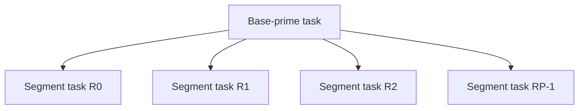
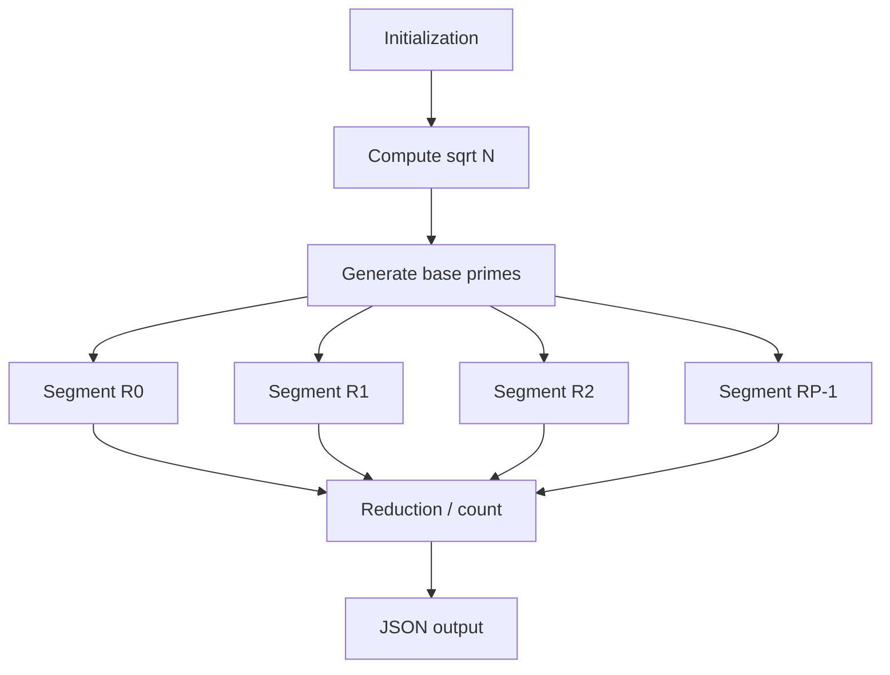

# PADC Analysis: Parallel Sieve of Eratosthenes Using OpenMP

This document describes the active implementation in `cpp/`, which is the code built into `backend/bin/` and used by the web API. The older `submission/` sources are not the application implementation and are not used for these measurements.

## Reproducibility

Build with warnings enabled from the repository root:

```powershell
g++ -O2 -Wall -Wextra -std=c++17 -o backend\bin\sieve_serial.exe cpp\sieve_serial.cpp
g++ -O2 -Wall -Wextra -std=c++17 -fopenmp -o backend\bin\sieve_openmp.exe cpp\sieve_openmp.cpp
python tests\test_sieves.py
python benchmarks\run_scalability.py
```

CLI usage is `sieve_serial N [return_primes=1] [timing_repetitions=1]` and `sieve_openmp N [threads=4] [return_primes=1] [timing_repetitions=1]`. The optional repetition argument is for benchmark precision; normal API and UI calls use one run. Benchmark output is written to ignored local files in `benchmarks/` so each machine records its own evidence.

## Module I: Serial Sieve

### 1. Objective and description

The Sieve of Eratosthenes finds every prime `<= N`. It is a useful PADC baseline because it has a known correct sequential algorithm, regular indexed data, explicit control/data dependencies, and enough work at large `N` to study OpenMP overhead and speedup.

### 2. Algorithm and flow

```text
SERIAL-SIEVE(N)
  is_prime[0..N] <- true
  is_prime[0] <- is_prime[1] <- false
  for p <- 2 while p*p <= N
    if is_prime[p]
      for multiple <- p*p to N step p
        is_prime[multiple] <- false
  count true entries in [2, N]
```

Only candidates through `sqrt(N)` are required: every composite `c <= N` has a factorization `c = a*b` in which at least one factor is `<= sqrt(c) <= sqrt(N)`. Marking starts at `p*p`, not `2*p`, because each lower multiple of `p` has an earlier factor and was already marked by a smaller prime.

### 3. Demonstration for N = 30

| Stage | Mark from | Newly relevant composites |
| --- | ---: | --- |
| `p = 2` | 4 | 4, 6, 8, ..., 30 |
| `p = 3` | 9 | 9, 15, 21, 27 |
| `p = 5` | 25 | 25 |

Remaining primes are `2 3 5 7 11 13 17 19 23 29`, so `pi(30) = 10`.

### 4. Complexity

The marking work is `N/2 + N/3 + N/5 + N/7 + ...` over primes, which is `O(N log log N)`. The serial implementation stores one byte-like primality value per input number, so its space is `O(N)`.

## Module II: Parallel OpenMP Sieve

### 5. Tasks and dependencies

| Task | Role | Parallelism |
| --- | --- | --- |
| T1 | Initialize sieve storage | Per-run setup; array initialization is independent but kept inside each block run. |
| T2 | Compute `sqrt(N)` and base primes | Serial prerequisite. |
| T3 | Mark composites in disjoint blocks | Parallel. |
| T4 | Count primes per block and reduce | Parallel local counts plus OpenMP reduction. |
| T5 | Emit JSON result | Serial after the implicit barrier. |

The ordinary outer `p` loop is not blindly parallelized: sharing it would allow concurrent writes throughout the full domain. Instead, the serial base-prime task precedes segment tasks. For a block `[low, high]` and base prime `p`, the first write is:

```text
first_multiple = max(p*p, ceil(low / p) * p)
```

The implementation uses integer ceiling division: `((low + p - 1) / p) * p`.

### 6. Domain/data decomposition

The domain `[2, N]` is partitioned into fixed 32,768-element blocks. With `P` workers, OpenMP statically maps these blocks to workers. Thus `D = R0 union R1 ... union R(P-1)` and `Ri intersection Rj = empty` for `i != j` at each scheduled block assignment. For example, conceptual four-way range ownership for `N=100` is `2-25`, `26-50`, `51-75`, and `76-100`.

Each worker reads the same `base_primes` list but writes only its assigned block range. The active implementation stores the full output array for API prime-list support; this is `O(N)` plus `O(sqrt(N))` base-prime storage. It has no concurrent writes to one array element.

### 7. Dependency and race analysis

- **Data dependency:** base-prime generation must complete before segment marking. Independent segments have no dependency on one another.
- **Computational dependency:** `sqrt(N) -> base primes -> marking -> reduction -> output`.
- **Control dependency:** the serial base sieve executes marking only when `is_prime[p]` is true.
- **Resource dependency:** cores contend for memory bandwidth, cache capacity, and the shared-memory subsystem even when logical writes are disjoint.
- **Race analysis:** `base_primes` is shared read-only; `is_prime` locations are written by one owned block; loop indices, bounds, first multiple, and local count are private; `prime_count` uses `reduction(+:prime_count)`. No `critical`, lock, or atomic appears in the dominant marking loop.
- **Synchronization:** the `single` section records observed team size, then its implicit barrier precedes `omp for`. The worksharing loop has an implicit barrier before output. No extra manual barrier is necessary.

### 8. Granularity and PCAM

Individual composite writes are too fine-grained: task creation and synchronization would dominate useful work. A block is a coarse-grained work unit containing initialization, marking, and counting.

| PCAM stage | Applied design |
| --- | --- |
| Partitioning | Split `[2,N]` into contiguous 32,768-value blocks. |
| Communication | Share read-only `N` and `base_primes`; OpenMP requires no explicit messages. |
| Agglomeration | Combine all marking/counting for a block into one scheduled iteration. |
| Mapping | `#pragma omp for schedule(static)` maps comparable blocks reproducibly to the OpenMP team. |

Static scheduling is appropriate because blocks have equal capacity. Actual marking work varies slightly with prime density, so completion is governed by the slowest worker; increasing block count supplies work to balance this without one task per composite.

### 9. TIG and TDG



This task interaction graph is one-to-many: all segment tasks read the common base-prime list; segment tasks do not communicate directly while marking.



The critical path is approximately `Tp = T_init + T_base + max(T_segment_i) + T_reduction + overhead`. The maximum degree of concurrency is `P` during segment marking, subject to enough blocks; it is one during setup/output. Average parallelism is total work divided by critical-path length.

### 10. Shared/private variables and OpenMP implementation

The code uses `omp_set_num_threads`, `omp_get_wtime`, `omp_get_num_threads`, `parallel`, `single`, `for schedule(static)`, and a reduction. Shared data are `limit`, `base_primes`, and the full sieve storage with disjoint block ownership. Private data are block/index variables, bounds, first multiple, and local count. `actual_threads` is assigned once in `single`; the JSON response reports both requested and observed team size.

## Correctness Evidence

`tests/test_sieves.py` runs edge rejection for `N < 2`, then checks these actual counts and compares complete serial/OpenMP prime lists through one million:

| N | Expected prime count | OpenMP thread counts checked |
| ---: | ---: | --- |
| 2 | 1 | 1, 2, 4, 8 |
| 3 | 2 | 1, 2, 4, 8 |
| 30 | 10 | 1, 2, 4, 8 |
| 100 | 25 | 1, 2, 4, 8 |
| 1,000,000 | 78,498 | 1, 2, 4, 8 |

The current test command completed with `PASS: serial/OpenMP edge, known-count, and prime-list checks`.

## Timing Methodology and Actual Strong-Scaling Results

Measurements were generated on 2026-08-30 with Windows 11, 8 logical CPUs, `g++ (tdm64-1) 9.2.0`, and `-O2 -Wall -Wextra -std=c++17` (`-fopenmp` for OpenMP). Each configuration has one unmeasured warm-up, five measured process invocations, and 20 in-process computational repetitions per invocation. The table reports the median per-sieve time; printing is excluded. Raw samples, standard deviations, cost, and overhead are in `benchmarks/scalability_results.csv` generated by the command above.

| N | Threads | Serial median ms | OpenMP median ms | Speedup S(P) | Efficiency E(P) | Cost P*Tp ms |
| ---: | ---: | ---: | ---: | ---: | ---: | ---: |
| 100,000 | 1 | 0.134350 | 0.150001 | 0.895660 | 0.895660 | 0.150001 |
| 100,000 | 2 | 0.134350 | 0.199997 | 0.671759 | 0.335879 | 0.399995 |
| 100,000 | 4 | 0.134350 | 0.249994 | 0.537413 | 0.134353 | 0.999975 |
| 100,000 | 8 | 0.134350 | 0.450003 | 0.298553 | 0.037319 | 3.600025 |
| 1,000,000 | 1 | 2.613750 | 1.650000 | 1.584091 | 1.584091 | 1.650000 |
| 1,000,000 | 2 | 2.613750 | 1.099992 | 2.376154 | 1.188077 | 2.199984 |
| 1,000,000 | 4 | 2.613750 | 0.950003 | 2.751308 | 0.687827 | 3.800011 |
| 1,000,000 | 8 | 2.613750 | 0.949991 | 2.751343 | 0.343918 | 7.599926 |
| 10,000,000 | 1 | 51.572050 | 17.799997 | 2.897307 | 2.897307 | 17.799997 |
| 10,000,000 | 2 | 51.572050 | 9.249997 | 5.575358 | 2.787679 | 18.499994 |
| 10,000,000 | 4 | 51.572050 | 5.799997 | 8.891738 | 2.222934 | 23.199987 |
| 10,000,000 | 8 | 51.572050 | 3.699994 | 13.938414 | 1.742302 | 29.599953 |

`S(P) = Ts / Tp`, `E(P) = S(P) / P`, and `C(P) = P * Tp`. These are observed values, not theoretical claims. Small `N` shows overhead and variation; 10M benefits more from parallel marking. The OpenMP one-thread figure can differ from serial because its block-organized marking layout is not identical to the serial loop layout. Do not infer universal speedup or exact cost optimality from one machine.

## Theory, Scalability, and Limits

Under ideal assumptions the dominant marking work can approach `O(N log log N / P)`, plus serial base-prime work, reduction, memory effects, and runtime overhead. Strong scaling fixes `N` and increases `P` through 1, 2, 4, and 8, as in the table. Speedup eventually saturates because of serial setup, barriers, scheduling, cache behavior, and memory bandwidth. For small inputs, OpenMP team management and synchronization can cost more than the saved work.

For Amdahl's Law, `S(P) = 1 / ((1-f) + f/P)`. This is theory, not a measured fit here. If an illustrative `f = 0.95`, then `S(4) = 1 / (0.05 + 0.95/4) ~= 3.48`, with maximum `Smax = 1/(1-f) = 20`. The serial fraction and hardware contention bound real performance.

The code does not implement MPI, GPU, SIMD intrinsics, power measurement, a profiler trace, or per-thread timing diagnostics. Those are possible extensions, not claims. A future diagnostic mode could record block assignment and local work/time to quantify load imbalance; the present static design avoids shared write races but cannot remove shared-resource contention.
